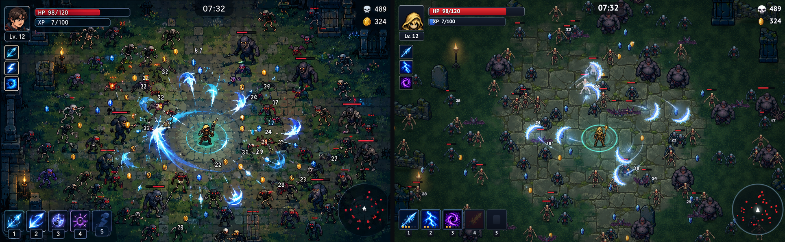

# Пиксельная арена

Браузерная игра в жанре horde survival (как Vampire Survivors): вид сверху 3/4, HD pixel art, тёмное фэнтези. Сделана по
референсу `ref.png` скиллом [ref2game](https://github.com/studioigor/ref2game). Арт сгенерирован (Codex image_gen), всё
движущееся — код: крошечный движок на WebGL2, cut-out риги, эффекты, свет, звук.



## Запуск

```bash
cd live && python3 -m http.server 8930
# открыть http://127.0.0.1:8930/index.html
```

WebGL нельзя открыть с `file://`, нужен любой статический сервер.

## Управление

| Клавиша | Действие |
|---|---|
| любая клавиша / клик | начать забег (до этого крутится 30-секундное демо) |
| WASD / стрелки | движение, оружие бьёт само |
| 1–3, ←/→ + Enter, клик | выбор карты при новом уровне |
| 4 | обновить карты (бесплатно, потом 50 золота) |
| 5 | взять все три карты за золото |
| пробел (в бою) | скорость игры ×2 → ×4 → ×1 |
| встать в золотой рунный круг | лавка алтаря: стрелки + Enter или клик — купить, Esc — уйти |
| наведение мыши | подсказка: слот оружия, плитка бафа, карта улучшения |
| Q | по кругу: автопилот (сам ходит и выбирает улучшения) → автоход (сам ходит, улучшения выбираете вы) → выкл; WASD перехватывает управление |
| M | звук вкл/выкл |
| Esc | пауза |
| R | новый забег |

`?auto=1` в адресе сразу запускает бесконечный автоплей.

## Что в игре

- **Оружие:** ледяной жезл (спираль когтей из посоха), молния (ветвящийся разряд с цепью), чёрная дыра (стягивает и
  перемалывает), огненный меч (клинки по орбите). У каждого 10 уровней: 1–5 обычные (золотые огоньки в слоте), 6–10
  пробуждённые (фиолетовые).
- **Враги:** гуль, скелет, летучая мышь, громила. Волны каждую минуту чередуются: стая мышей, сжимающееся кольцо
  скелетов, элитный громила с сундуком (+1 уровень оружию); с номером волны они растут. Каждая 5-я волна приводит вожака
  (гигантский громила, двойной сундук). С 8:00 среди обычных врагов попадаются чемпионы (красный контур, ×4 здоровья).
  Здоровье, урон, скорость и число врагов растут весь забег (`CURVE` в `sim.js`), победа на 30:00.
- **Прокачка:** каждый новый уровень улучшает оружие (три карты; «Взять все» за золото). Когда всё оружие на 10-м уровне,
  вместо него мешок золота, «Дар» (случайный баф +1 ранг) и лечение.
- **Лавки:** четыре алтаря на арене (золотые круги, видны на миникарте). За золото покупаются ранги бафов: Мощь, Спешка,
  Криты (шанс и множитель), Радиус (оружие и магнит), Здоровье, Броня, Регенерация, Скорость, Толчок, Вампиризм,
  Длительность, Опыт, Удача, Количество (+1 снаряд всему оружию), Золото, и разовое лечение. Купленные бафы видны слева
  плитками с огоньками рангов.
- **Вожак** оставляет двойной сундук, кольцо больших кристаллов, кучу золота, бесплатный ранг случайного бафа и лечит на 30%.
- **Живой мир:** риги с бегом и фазой полёта, падение с отскоком при смерти, ветер в кустах и пламени, отклик на каждое
  событие (вспышки, искры, тряска, цифры урона), синтезированный звук.

## Структура

| Путь | Что |
|---|---|
| `live/` | игра: `sim.js` (детерминированная симуляция 120 Гц), `scene.js` (отрисовка, эффекты, HUD), `lib.js`/`gl.js` (движок), `audio.js`, `assets/` + `assets.js` (готовые текстуры), `rigs.js` (суставы ригов) |
| `art/raw/` | исходный вывод генератора |
| `art/prompts/`, `art/style_bible.txt` | промпты всех ассетов |
| `tools/` | пайплайн ассетов: `finish.py` (ключ → чистка → LAB-грейд → нарезка ригов → prep), `hero_split.py`, `batcut.py`, `derive_brute.py`, `rigclean.py`, `show_rig.py` |
| `study/` | разбор референса: `STYLE.md`, `PLAN.md`, `MATCH.md`, кропы, отчёты критиков в `study/critique/` |
| `ref.png`, `ref2game.json` | референс и конфиг генератора |

## Пересборка ассетов

Нужен установленный скилл ref2game (`~/.claude/skills/ref2game`) и Python-зависимости: `pip install -r requirements-dev.txt`.

```bash
python3 tools/finish.py            # все ассеты из art/raw → art/gen → live/assets
python3 tools/finish.py skeleton   # один ассет (ключ, грейд, риг)
```

## Проверки

```bash
S=~/.claude/skills/ref2game/scripts
node $S/qa.mjs                     # HUD в худших случаях, точка вылета снарядов, походка ригов, эффекты
node live/tune.cjs                 # демо доходит до своих моментов
flake8 .                           # wemake-python-styleguide для tools/ (конфиг в setup.cfg)
node $S/livecheck.mjs --shots 2    # ошибки страницы и fps
python3 $S/pack.py --name pixel-arena --zip   # статическая сборка в dist/
```

## Известные отличия от референса

- Герой в капюшоне и всегда смотрит в камеру (нет боковых и задних ракурсов).
- Нарисованные пиксели спрайтов мельче, чем на референсе; разница прикрыта контуром.
- Нет склепов, гробниц и мусора на земле; цифры урона гладким шрифтом.
